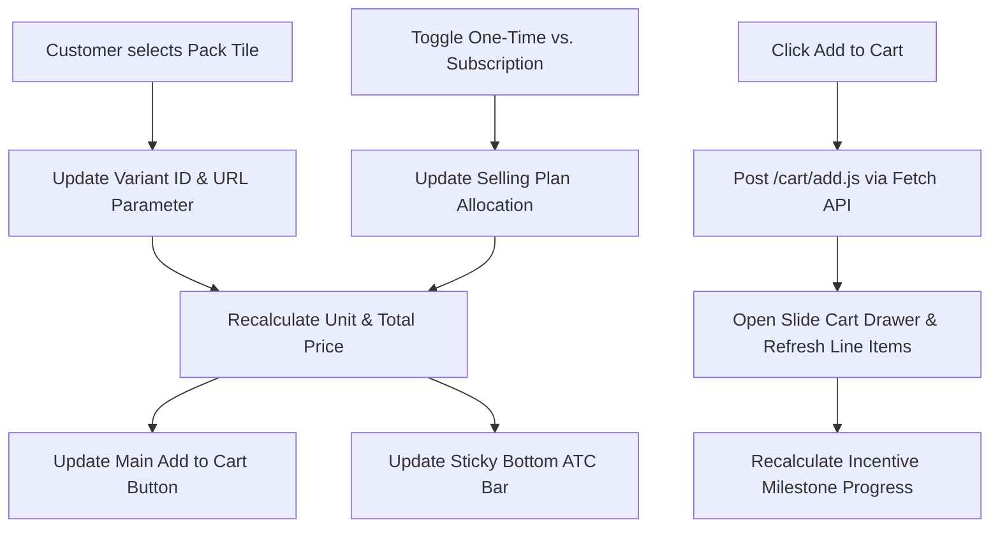

# SPEC-01: Spec-Driven Development Architecture & Implementation Plan
**Document Version:** 1.2.0  
**Status:** APPROVED FOR SPRINT 2 (100% SPEC-DRIVEN DEVELOPMENT READY — INTERFACE CONTRACTS, DATA ISLANDS, DEGRADATION MATRIX & SKELETON ARCHITECTURE LOCKED 2026-11-11)  
**Target:** `Shopify/skeleton-theme` + Modern Theme Blocks (Block-First Architecture, Theme Store Compliant)  
**Niche:** Specialty Consumables (Coffee, Tea, Supplements, Functional Foods)  
**Figma Canvas Reference:** `Stickersheet` (`26:65`) · `Spec 1` (`571:1522`) · `Components Audited` (`450:13`)

---

## 1. Executive Summary & Conversion Thesis

General Shopify themes treat products as visual commodities: `Image -> Color/Size -> Add to Cart`. In contrast, specialty consumables (specialty coffee, functional supplements, adaptogenic teas) require customer trust, sensory expectation, and clear unit economics. 

The PDP must guide the customer along a 5-stage cognitive funnel:
$$\text{Understand} \longrightarrow \text{Evaluate} \longrightarrow \text{Trust} \longrightarrow \text{Choose} \longrightarrow \text{Commit}$$

This document formalizes the complete technical, functional, and design specifications required to build the theme natively on **`Shopify/skeleton-theme`** with **Vanilla Web Components**, **strict CSS Custom Properties**, and **Shopify Modern Nested Theme Blocks** (`blocks/`), eliminating recurring monthly app subscriptions ("Essential App Tax") while meeting 100% of Shopify Theme Store eligibility rules.

---

## 2. Design Tokens & CSS Custom Properties

All design tokens are extracted directly from the Figma variable collection on `Stickersheet` (`26:65`). **Zero raw hex codes or hardcoded pixel spacing are permitted in CSS.**

### 2.1 CSS Custom Properties Dictionary

```css
:root {
  /* --- Primitive Tier (14 Pure Primitives — Brand & Structural Anchors) --- */
  --primitive-coffee-black: #151c25;
  --primitive-coffee-brown: #a18263;
  --primitive-green: #344435;
  --primitive-supp-turquoise: #00bc8e;
  --primitive-supp-coral: #c5452c;
  --primitive-white: #ffffff;
  --primitive-coffee-cream: #f6ebe0;
  --primitive-neutral-off-white: #fafafa;
  --primitive-neutral-subtle: #efefef;
  --primitive-neutral-track: #d2d2d2;
  --primitive-neutral-border: #e0d8d2;
  --primitive-neutral-muted: #555f6d;
  --primitive-neutral-divider: rgba(198, 198, 205, 0.6);
  --primitive-black-overlay: rgba(0, 0, 0, 0.4);

  /* --- Spacing Scale (4px Base Grid) --- */
  --space-xxs: 4px;
  --space-xs: 6px;
  --space-sm: 8px;
  --space-md: 12px;
  --space-lg: 16px;
  --space-xl: 20px;
  --space-2xl: 24px;

  /* --- Geometry & Radii --- */
  --radius-none: 0px;
  --radius-xs: 4px;
  --radius-sm: 8px;
  --radius-sm-md: 12px;
  --radius-md: 16px;
  --radius-lg: 32px;
  --radius-full: 999px;
  --radius-panel-flat: 8px;
  --radius-panel-photo: 16px;

  /* --- Strokes & Metrics --- */
  --stroke-hairline: 1px;
  --stroke-emphasis: 2px;
  --gauge-diameter: 46px;
  --gauge-ring-thickness: 9px;

  /* --- Elevation & Shadows --- */
  --shadow-subtle: 0px 1px 2px rgba(0, 0, 0, 0.05);

  /* --- Surface, Border & System Utility Tokens (Common) --- */
  --surface-container: var(--primitive-white);
  --surface-track: var(--primitive-neutral-track);
  --surface-overlay: var(--primitive-black-overlay);
  --border-default: var(--primitive-neutral-border);
  --border-divider: var(--primitive-neutral-divider);
  --color-error: #d72c0d;
  --color-success: #008060;
}

/* --- Skin 1: Specialty Coffee (Warm, Editorial, Artisan) --- */
[data-skin="skin-1"] {
  --color-primary: var(--primitive-coffee-black);       /* #151c25 — Primary CTA, Inverted H2 */
  --color-secondary: var(--primitive-coffee-brown);     /* #a18263 — Badges, Sticky ATC, Gauge Fill */
  --color-tertiary: var(--primitive-green);             /* #344435 — Active selection badges */

  --text-primary: var(--primitive-coffee-black);        /* #151c25 (14.60:1 on bg-main) */
  --text-muted: var(--primitive-neutral-muted);         /* #555f6d (5.51:1 on bg-main) */
  --text-accent: var(--primitive-coffee-brown);         /* #a18263 (1-hop to coffee-brown) */
  --text-inverse: var(--primitive-white);               /* #ffffff (10.37:1 on dark overlays) */
  --text-on-primary: var(--primitive-white);            /* #ffffff (17.15:1 on color-primary) */
  --text-on-secondary: var(--primitive-coffee-black);   /* #151c25 (4.81:1 on color-secondary) */
  --text-on-tertiary: var(--primitive-white);           /* #ffffff (10.37:1 on color-tertiary) */

  --bg-main: var(--primitive-coffee-cream);             /* #f6ebe0 — Warm Parchment */
  --surface-subtle: var(--primitive-coffee-cream);      /* #f6ebe0 — Subtle neutral chips inside white cards */
  --surface-inverted: var(--primitive-coffee-brown);    /* #a18263 */
  --border-selected: var(--primitive-green);            /* #344435 (8.83:1 on bg-main) */

  /* Typography */
  --font-heading: 'Literata', serif;
  --font-body: 'Inter', sans-serif;
  --h2-size: 24px;
  --h2-line-height: 27.5px;
  --h2-letter-spacing: -0.5px;
  --h4-size: 18px;
  --h4-line-height: 24px;
  --body-size: 14px;
  --body-line-height: 20px;
  --label-size: 12px;
  --label-line-height: 16px;
  --label-letter-spacing: -0.5px;
}

/* --- Skin 2: Functional Supplement (Clean, Scientific, Energetic) --- */
[data-skin="skin-2"] {
  --color-primary: var(--primitive-supp-turquoise);     /* #00bc8e — Primary CTA, Inverted H2 */
  --color-secondary: var(--primitive-supp-coral);       /* #c5452c — Savings, Highlight Badges, Accent Header */
  --color-tertiary: var(--primitive-coffee-black);      /* #151c25 — Active selection badges */

  --text-primary: var(--primitive-coffee-black);        /* #151c25 (16.43:1 on bg-main) */
  --text-muted: var(--primitive-neutral-muted);         /* #555f6d (6.20:1 on bg-main) */
  --text-accent: var(--primitive-supp-coral);           /* #c5452c (4.72:1 on bg-main) */
  --text-inverse: var(--primitive-white);               /* #ffffff (17.15:1 on surface-inverted) */
  --text-on-primary: var(--primitive-coffee-black);     /* #151c25 (7.01:1 on turquoise CTA) */
  --text-on-secondary: var(--primitive-white);          /* #ffffff (4.93:1 on coral badges/Sticky ATC) */
  --text-on-tertiary: var(--primitive-white);           /* #ffffff (17.15:1 on color-tertiary) */

  --bg-main: var(--primitive-neutral-off-white);        /* #fafafa */
  --surface-subtle: var(--primitive-neutral-subtle);    /* #efefef — Cool gray neutral chips visible on white cards */
  --surface-inverted: var(--primitive-coffee-black);    /* #151c25 */
  --border-selected: var(--primitive-coffee-black);     /* #151c25 (16.43:1 on bg-main) */

  /* Typography */
  --font-heading: 'Gasoek One', cursive;
  --font-body: 'Source Code Pro', monospace;
  --font-label: 'Inter', sans-serif;
  --h2-size: 24px;
  --h2-line-height: 28px;
  --h2-letter-spacing: 0px;
  --h4-size: 16px;
  --h4-line-height: 20px;
  --body-size: 14px;
  --body-line-height: 20px;
  --label-size: 12px;
  --label-line-height: 16px;
  --label-letter-spacing: 0px;
}
```

---

## 3. Engineering Architecture & Agent Rules

Adherence to the governing engineering rules (`05-Agent-Rules.md`) is mandatory:

1. **Vanilla Web Components Only:**  
   Custom elements (e.g., `<pack-selector>`, `<gauge-metric>`, `<cart-drawer>`, `<sensory-radar>`, `<telemetry-grid>`) encapsulate behavior without React, jQuery, or bloated runtime dependencies.
2. **Asynchronous Viewport Hydration:**  
   Components register an `IntersectionObserver` and defer DOM listener initialization until the element approaches the viewport.
3. **Skeleton Theme + Block-First Composition (Theme Store Compliant):**  
   Built on `Shopify/skeleton-theme` (never forked from `Dawn` or `Horizon`). Direct composition via `` in templates and granular nested block slots (``) plus required `@app` block support so merchants can reorder badges, profile widgets, facts tables, and buying controls via the theme editor.
4. **Data Isolation:**  
   Shopify Liquid outputs clean JSON payloads inside `<script type="application/json">` islands, decoupled from markup classes.
5. **60 FPS Micro-Animation & Telemetry Engine (Onyx ScrollTide Pattern):**  
   Sensory gauges, roast spectrum bars, and sticky controls utilize hardware-accelerated CSS properties (`transform`, `opacity`, `stroke-dashoffset`) driven by a lightweight `requestAnimationFrame` tick loop (`assets/anim-scrubber.js`) and native `IntersectionObserver` triggers. Zero heavy animation runtimes (no bloated GSAP, Three.js, or jQuery).

---

## 4. Content Model & Metafield Contracts

Data contracts driving the theme's dynamic behavior across consumables verticals:

### 4.1 Product Metafields (`namespace: custom`)

| Metafield Key | Type | Description / Data Contract |
| :--- | :--- | :--- |
| `custom.profile_gauges` | `json` or `list.metaobject_reference` | Array of `{ label: String, score: Number (1-5), max: 5 }`. Powers `Gauge Metric` in Coffee/Tea. |
| `custom.profile_benefit_chips` | `list.single_line_text_field` | Array of short claims (e.g., `["Clean Focus", "Zero Crash", "USDA Organic"]`). |
| `custom.roast_level` | `number_integer` or `single_line_text_field` | Roast spectrum (1-5 or Agtron reading) powering the visual roast intensity bar. |
| `custom.origin_telemetry` | `json` | Roaster & terroir telemetry: `{ elevation: String, process: String, variety: String, station: String, producer: String }`. |
| `custom.cupping_profile` | `json` | Sensory cupping telemetry: `{ acidity: Number (1-5), sweetness: Number, body: Number, clean_cup: Number, finish: Number }`. Powers pure-SVG radar. |
| `custom.multi_brew_recipes` | `json` | Tabbed brew guides: `[{ method: "Kalita Wave", dose: "24g", yield: "380g", ratio: "1:16", grind: "Medium-Coarse", temp: "205°F", time: "3:30" }]`. |
| `custom.facts_table` | `json` | Structured nutrition/supplement rows: `{ serving_size: String, servings_per_container: Number, items: [{ name: String, amount: String, dv_percent: String }] }`. |
| `custom.brewing_guide` | `json` | Single preparation guide: `{ grind: String, ratio: String, temp: String, time: String }`. |
| `custom.ingredients` | `rich_text` | Full list of active and inactive ingredients. |
| `custom.allergens` | `single_line_text_field` | Allergen statements or facility disclosures. |
| `custom.unit_servings` | `number_integer` | Servings/units count per variant, used to compute price-per-serving dynamically. |
| `custom.origin_story` | `json` | Origin details & modal data: `{ region: String, altitude: String, producer: String, story: String, image: File }`. |

### 4.2 Metaobjects

* **Certification Badges (`custom.cert_badge`):**
  * `icon`: `file_reference` (SVG/PNG)
  * `label`: `single_line_text_field` (e.g., "Direct Trade", "Fair Trade", "Vegan", "Gluten-Free")
* **Trust Reassurance (`custom.trust_item`):**
  * `icon_key`: `single_line_text_field` (Phosphor icon identifier)
  * `title`: `single_line_text_field`
  * `subtitle`: `single_line_text_field`
* **Sourcing Transparency (`custom.origin_disclosure`):**
  * `farm_name`: `single_line_text_field`
  * `fob_price`: `single_line_text_field` (e.g. "$4.50/lb vs $1.80 C-Market")
  * `lot_size`: `single_line_text_field`
  * `narrative`: `rich_text`

---

## 5. Component Inventory & Specification

Components audited against Figma node `450:13` (`Components Audited`) and upgraded with Onyx Coffee Lab sensory telemetry:

### 5.1 Zone 1: Sensory & Trust (Header & Identification)

#### `header-pdp` (`544:2386`)
* **Variants:** `Scheme=Default`, `Scheme=Accent`
* **Behavior:** Sticky on scroll-up; condensed brand bar with back button, cart icon with dynamic badge count.

#### `image-gallery` (`489:2190`)
* **Variants:** `Orientation=Horizontal` (Mobile swipe/snap), `Orientation=Vertical` (Desktop side-stack).
* **Specifications:** Aspect ratio 1:1, explicit image height/width attributes for CLS = 0, interactive pagination dots (`space-xxs` gap), lazy loading on slides beyond index 0.

#### `product-meta-stack` (`491:737`)
* **Elements:** Brand subtitle (`Label/Mobile`), Product Title (`H2/Mobile`), Star rating (`Rating` subcomponent with review count link), Price display.

#### `roaster-telemetry` (Onyx Telemetry Module)
* **Elements:** 4 structured technical chips arranged in a clean horizontal grid:
  1. **Elevation:** `1,700–2,000 MASL` (Mountain icon)
  2. **Process:** `Natural` / `Washed` / `Anaerobic` (Drop/Leaf icon)
  3. **Variety:** `SL28, SL34, Geisha` (Seed icon)
  4. **Roast Level:** Visual 5-segment Agtron spectrum bar (`Light` $\rightarrow$ `Dark`) with active fill indicator.

#### `sensory-radar-chart` / `gauge-metric` (`481:1810`)
* **Gauge Metric (Atoms):** Diameter exactly 46px (`--gauge-diameter`), ring thickness 9px (`--gauge-ring-thickness`, 60.87% inner arc ratio), animated arc fill (`--color-secondary`), centered score (`14px Bold`), label beneath (`12px Regular`).
* **Sensory Radar (Composite):** Pure-SVG polygonal radar chart driven by `custom.cupping_profile`. No D3.js or external JS. Viewport entry animates polygon scale and stroke via CSS.

#### `trust-row` (`491:793`)
* **Slot:** Auto-layout row (`space-md` gap) holding 3 `trust-item` instances.
* **Icon Standard:** Phosphor Regular line icons with unified 20px stroke bounding box (`currentColor` inheritance).

---

### 5.2 Zone 2: The Economic Decision (Buying Machine)

```
+--------------------------------------------------------------+
|                     ZONE 2 BUYING ENGINE                     |
|                                                              |
|  [ 1 Bag ($20) ]    [ 2 Bags ($36) - Save 10% ]  <-- Tiles   |
|                                                              |
|  (•) One-Time Purchase          ( ) Subscribe & Save (15%)   |
|      Deliver every: [ 2 Weeks ] [ 4 Weeks ] [ 6 Weeks ]      |
|                                                              |
|  [============== ADD TO CART - $30.60 ==============]        |
+--------------------------------------------------------------+
```

#### `pack-selector` (`477:1068`)
* **Figma Master Symbols:**
  * `State=Selected, Type=Regular` (`477:1067`)
  * `State=Selected, Type=Popular` (`477:1136` with "Most Popular" badge)
  * `State=Not Selected, Type=Popular` (`477:1066`)
  * `State=Not Selected, Type=Regular` (`477:1065`)
* **Behavior:** Clicking a tile updates the selected Shopify variant ID, recalculates per-unit savings badge, and synchronizes the sticky ATC bar.

#### `subscription-toggle` (`482:1819` + `483:1836`)
* **Segmented Control (`482:1819`):** 2 tabs: "One-time purchase" vs "Subscribe & Save".
* **Frequency Selector (`483:1836`):** Selectable cadence tiles (e.g., 2 weeks, 4 weeks, 8 weeks).
* **Micro-Copy:** "Auto-renews, skip or cancel anytime" with lock icon.

#### `sticky-add-to-cart` (`489:2232`)
* **Variants:** `Position=Bottom` (Mobile default), `Position=Top` (Desktop alternative).
* **Trigger:** Appears when the primary Add to Cart button scrolls out of the viewport.
* **Synchronization:** Mirrored variant state, quantity, and live price.

---

### 5.3 Zone 3: Functional Transparency & Proof

#### `facts-panel` (`483:1847`)
* **Variant A (`panel-flat`):** Nutrition / Serving Facts. 8px radius, borderless container. Displays Servings per container, Serving size, Caffeine/Calories, Ingredients rich text, and Allergen disclosures.
* **Variant B (`panel-photo`):** Origin & Sourcing story with background card imagery (16px radius).

#### `brewing-recipe-tabs` (Onyx Interactive Brew Recipe Engine)
* **Format:** Segmented method switcher (Kalita Wave, V60, Aeropress, Espresso) populated from `custom.multi_brew_recipes`.
* **Telemetry Grid:**
  1. **Ratio / Dose:** e.g., "24g / 380g (1:16)"
  2. **Grind Size:** e.g., "Medium-Coarse (22 Clicks)"
  3. **Water Temp:** e.g., "205°F / 96°C"
  4. **Brew Time:** e.g., "3:30 min"

#### `origin-story-modal` (`#stat-origin`)
* **Behavior:** Lightweight modal / slide-over dialog that provides transparent farm history, FOB price contracts, and direct-trade disclosures without navigating away from the PDP.

---

### 5.4 Zone 4 & Cart Drawer

#### `cart-drawer` (`494:1215`)
* **Figma Frames:** `Cart drawer Skin 1` (`494:5482`), `Cart drawer Skin 2` (`504:2022`).
* **Subcomponents:**
  * **Tiered Incentive Progress Bar (`509:2468`):** Unlocks milestones: (1) Free Shipping ($35) $\rightarrow$ (2) Free Sample Bag ($60).
  * **Line Item Card (`509:2469`):** Image thumbnail, variant title, cadence badge ("Delivered every 4 weeks"), quantity stepper (`-`, `qty`, `+`), delete button.
  * **Pair With Your Order Carousel (`494:5611`):** In-cart upsell product cards with 1-click Quick Add.
  * **Checkout Summary Stack:** Subtotal, dynamic "You saved: $XX" highlight pill, checkout CTA button.

---

### 5.5 60 FPS Micro-Animation Scrubber Architecture (`assets/anim-scrubber.js`)

Inspired by Onyx Coffee Lab's `ScrollTide` engine, our animation engine eliminates heavy JavaScript frameworks:
* **Core Loop:** Uses a single `requestAnimationFrame` observer that monitors element scroll progress:
  $$\text{Progress} = \frac{\text{ScrollY} + \text{WindowHeight} \times \text{Offset} - \text{ElementTop}}{\text{ElementHeight}}$$
* **Hardware-Accelerated Execution:** Modifies only CSS custom properties (`--anim-progress: 0.0 - 1.0`), driving GPU-accelerated SVG dash offsets and transforms with zero layout recalculation.
* **Graceful Degradation:** Defaults to standard CSS transitions if `prefers-reduced-motion: reduce` is detected.

---

## 6. Reactive State Engine: The Unified PDP Loop



---

## 7. Quality Assurance & Acceptance Criteria

| Checkpoint | Target Standard | Verification Method |
| :--- | :--- | :--- |
| **Token Purity** | 100% Tokenized CSS | Automated regex audit (`git grep '#[0-9a-fA-F]' -- assets/`) returns 0 matches in component styles. |
| **Lighthouse Performance** | Performance $\ge 96$, TBT $< 150\text{ ms}$, CLS $= 0$ | Tested on simulated Moto G4 4G throttle in Chrome DevTools. |
| **Accessibility** | WCAG 2.1 Level AA | Verified $\ge 4.5:1$ across all semantic text pairs: `Text/Primary` (14.6:1 / 16.4:1), `Text/On-Primary` (17.2:1 / 7.0:1), `Text/On-Secondary` (4.81:1 / 4.93:1), and `Text/Accent` (4.88:1 / 4.72:1). |
| **Zero App Overhead** | Native Execution | Pack selector, slide cart, tiered shipping bar, and subscription wrapper run without external app scripts. |
| **Fail-Safe Metafields** | Graceful Degradation | If `facts_table`, `origin_telemetry`, or `brewing_guide` metafields are empty, the corresponding blocks collapse cleanly without layout gaps. |

---

## 8. Figma Spec Synchronization

> [!NOTE]
> This document matches the structure and node references of **`Spec 1`** (`node-id=571:1522`) on the **`Stickersheet`** page (`26:65`).
> 
> Because remote MCP programmatic writes to canvas spec blocks require an Enterprise/Org plan with Specs Write API enabled, this Markdown file serves as the canonical Source of Truth in the project repository and can be copied directly into the Figma `Spec 1` canvas card.

---

## 9. Merchant CRO Customizer & Settings Schema Specification

> [!NOTE]
> **Status: ARCHITECTURAL PATTERN LOCKED · SPECIFIC COPY PENDING REFINEMENT**  
> The schema container mechanisms (`paragraph`, `header`, `info`) and guardrail hooks are established below. The exact benchmark figures, micro-copy, and specific guidance callouts will be iterated and refined as each component is built.

To establish our theme as an **opinionated conversion engine**, theme and block settings include built-in CRO benchmarks, psychological pricing rules, and setup alerts directly in the Shopify Theme Editor sidebar.

### 9.1 Multi-Pack Economics Settings (`blocks/pack-selector.liquid`)

```json
{
  "name": "Pack Economics Selector",
  "settings": [
    {
      "type": "header",
      "content": "💡 CRO Strategy: Multi-Pack Architecture"
    },
    {
      "type": "paragraph",
      "content": "Consumables brands convert up to **23% higher** when offering 3 distinct pack sizes. A **10–15% discount on Tier 2** creates a powerful cognitive anchor that shifts volume away from single-unit orders to maximize Average Order Value (AOV)."
    },
    {
      "type": "text",
      "id": "tier_2_badge",
      "label": "Tier 2 Badge Label",
      "default": "Most Popular — Save 10%",
      "info": "Highlighting Tier 2 as 'Most Popular' leverages social proof to steer default selection."
    },
    {
      "type": "checkbox",
      "id": "show_per_serving_price",
      "label": "Show Price Per Serving / Unit",
      "default": true,
      "info": "Requires `custom.unit_servings` metafield. Breaking high bundle prices into '$1.13 / cup' eliminates price shock."
    }
  ]
}
```

### 9.2 Subscription Engine Settings (`blocks/subscription-toggle.liquid`)

```json
{
  "name": "Subscription Wrapper",
  "settings": [
    {
      "type": "header",
      "content": "💡 CRO Strategy: Zero-Friction Subscriptions"
    },
    {
      "type": "paragraph",
      "content": "Top-converting brands avoid deceptive 'stealth subscriptions'. Clear dual-card toggles paired with explicit **'Skip or cancel anytime'** assurances eliminate customer checkout hesitation."
    },
    {
      "type": "text",
      "id": "sub_discount_badge",
      "label": "Subscription Savings Badge",
      "default": "Subscribe & Save 15%",
      "info": "The sweet spot for consumable subscription discounts is 15% to 20%."
    },
    {
      "type": "text",
      "id": "cancellation_reassurance",
      "label": "Reassurance Micro-Copy",
      "default": "Auto-renews. Skip, pause, or cancel anytime in 1 click."
    }
  ]
}
```

### 9.3 Cart Gamification & Shipping Tiers (`config/settings_schema.json`)

```json
{
  "name": "Cart Gamification (CRO)",
  "settings": [
    {
      "type": "header",
      "content": "💡 CRO Strategy: Tiered Milestone Gamification"
    },
    {
      "type": "paragraph",
      "content": "Set **Tier 1 (Free Shipping) 15–20% higher than your baseline AOV**. This nudges single-bag buyers to add an upsell or upgrade to a multi-pack. Set **Tier 2 (Free Gift/Sample) at 1.5x–2x AOV** to unlock premium orders."
    },
    {
      "type": "range",
      "id": "free_shipping_threshold",
      "min": 25,
      "max": 120,
      "step": 5,
      "unit": "$",
      "label": "Tier 1: Free Shipping Threshold",
      "default": 35
    },
    {
      "type": "range",
      "id": "free_gift_threshold",
      "min": 40,
      "max": 200,
      "step": 5,
      "unit": "$",
      "label": "Tier 2: Free Gift Threshold",
      "default": 60
    },
    {
      "type": "text",
      "id": "free_gift_name",
      "label": "Tier 2 Gift Description",
      "default": "Free Sample Bag Included"
    }
  ]
}
```

### 9.4 Defensive Metafield Guardrails & Alert Banners

```json
{
  "type": "paragraph",
  "content": "⚠️ **Setup Guardrail:** Ensure `custom.roast_level` and `custom.origin_telemetry` are populated in your Shopify Product Admin. If left blank, this block will automatically collapse cleanly with zero layout shift or whitespace gaps."
}
```

---

## 10. Component Event Bus Contract (Pub/Sub API)

To guarantee complete decoupling between Web Components, all cross-component communication is mediated via strongly typed Custom DOM Events dispatched on `document` with `{ bubbles: true, composed: true }`. No component directly queries or manipulates another component's internal DOM.

```
       [<pack-selector>]          [<subscription-toggle>]
              │                              │
              ▼                              ▼
  'theme:variant:change'           'theme:subscription:change'
              │                              │
              └──────────────┬───────────────┘
                             ▼
              [Shared Event Bus (Document)]
                             │
       ┌─────────────────────┼─────────────────────┐
       ▼                     ▼                     ▼
[<sticky-add-to-cart>]  [<add-to-cart-form>]  [<product-price>]
```

### 10.1 Event Dictionary & Payloads

#### 1. `theme:variant:change`
* **Emitter:** `<pack-selector>` or standard `<variant-selects>`
* **Trigger:** Customer clicks a pack tile or changes variant options.
* **Payload (`event.detail`):**
  ```typescript
  interface VariantChangeEventDetail {
    productId: number;
    variantId: number;
    title: string;
    price: number;                        // Integer in cents (e.g. 3600 = $36.00)
    compareAtPrice: number | null;        // Integer in cents or null
    formattedPrice: string;               // Formatted string (e.g. "$36.00")
    formattedCompareAtPrice: string | null;
    unitPrice: string | null;             // Dynamic per-unit calculation (e.g. "$18.00 / bag")
    unitServings: number | null;          // Servings count from custom.unit_servings
    savingsPercentage: number | null;     // Computed savings percent (e.g. 10)
    available: boolean;
    featuredImageId: number | null;
    sellingPlanAllocations: Array<{
      sellingPlanId: number;
      price: number;
      discountPercent: number;
    }>;
  }
  ```

#### 2. `theme:subscription:change`
* **Emitter:** `<subscription-toggle>`
* **Trigger:** Customer switches between One-Time and Subscription mode, or selects a cadence tile.
* **Payload (`event.detail`):**
  ```typescript
  interface SubscriptionChangeEventDetail {
    isSubscription: boolean;
    sellingPlanId: number | null;
    sellingPlanName: string | null;       // e.g. "Delivery every 4 weeks"
    discountPercent: number;              // e.g. 15
    calculatedPrice: number;              // Discounted price in cents
    formattedCalculatedPrice: string;     // "$30.60"
  }
  ```

#### 3. `theme:cart:add`
* **Emitter:** `<add-to-cart-form>`, `<sticky-add-to-cart>`, or Quick-Add buttons.
* **Trigger:** Customer triggers Add to Cart action.
* **Payload (`event.detail`):**
  ```typescript
  interface CartAddEventDetail {
    variantId: number;
    quantity: number;
    sellingPlanId: number | null;
    properties: Record<string, string>;   // e.g. { "_grind": "Whole Bean" }
  }
  ```

#### 4. `theme:cart:updated`
* **Emitter:** Cart Controller (after `/cart/add.js`, `/cart/change.js`, or `/cart/update.js` resolves).
* **Trigger:** Storefront cart state changes.
* **Listeners:** `<cart-drawer>`, `<header-cart-icon>`, `<cart-progress-bar>`.
* **Payload (`event.detail`):**
  ```typescript
  interface CartUpdatedEventDetail {
    cart: ShopifyCartObject;              // Full native Cart JSON object
    itemCount: number;
    totalPrice: number;                   // In cents
    formattedTotalPrice: string;
    milestoneProgress: {
      tier1Reached: boolean;              // Free Shipping status
      tier1Remaining: number;             // Cents remaining to Free Shipping
      tier2Reached: boolean;              // Free Gift status
      tier2Remaining: number;             // Cents remaining to Free Gift
    };
  }
  ```

#### 5. `theme:cart:open` & `theme:cart:close`
* **Emitter:** `<header-cart-icon>`, Cart Controller post-ATC, or Drawer backdrop click.
* **Listeners:** `<cart-drawer>`.
* **Payload (`event.detail`):** `{ source: string }` (e.g. `"atc"`, `"header"`, `"scrim"`).

#### 6. `theme:modal:open` & `theme:modal:close`
* **Emitter:** Telemetry chips (`[data-modal-target="stat-origin"]`), CoA view buttons.
* **Listeners:** `<telemetry-modal>`.
* **Payload (`event.detail`):** `{ modalId: string }`.

---

## 11. Liquid JSON Island Schema Contract (`product-data.json`)

To comply with **Agent Rule 4 (Data Isolation)**, Liquid generates a single, clean JSON payload inside `<script type="application/json" id="ProductData-{{ product.id }}">`. Web Components parse this data upon hydration, completely decoupled from HTML class names or Liquid markup.

### 11.1 JSON Schema Specification

```json
{
  "$schema": "http://json-schema.org/draft-07/schema#",
  "title": "ProductDataIsland",
  "type": "object",
  "required": ["id", "title", "handle", "available", "variants", "selectedVariantId"],
  "properties": {
    "id": { "type": "number" },
    "title": { "type": "string" },
    "handle": { "type": "string" },
    "available": { "type": "boolean" },
    "options": {
      "type": "array",
      "items": { "type": "string" }
    },
    "selectedVariantId": { "type": "number" },
    "unitServingsDefault": { "type": ["number", "null"] },
    "variants": {
      "type": "array",
      "items": {
        "type": "object",
        "required": ["id", "title", "price", "available", "options"],
        "properties": {
          "id": { "type": "number" },
          "title": { "type": "string" },
          "options": { "type": "array", "items": { "type": "string" } },
          "price": { "type": "number", "description": "Price in cents" },
          "compareAtPrice": { "type": ["number", "null"], "description": "Compare-at price in cents" },
          "available": { "type": "boolean" },
          "sku": { "type": ["string", "null"] },
          "unitServings": { "type": ["number", "null"] },
          "unitsPerPack": { "type": "number", "default": 1 },
          "featuredMediaId": { "type": ["number", "null"] },
          "savingsPercentage": { "type": ["number", "null"] },
          "badge": { "type": ["string", "null"] },
          "sellingPlanAllocations": {
            "type": "array",
            "items": {
              "type": "object",
              "properties": {
                "sellingPlanId": { "type": "number" },
                "name": { "type": "string" },
                "discountPercent": { "type": "number" },
                "price": { "type": "number", "description": "Discounted price in cents" }
              }
            }
          }
        }
      }
    },
    "sellingPlans": {
      "type": "array",
      "items": {
        "type": "object",
        "properties": {
          "id": { "type": "number" },
          "name": { "type": "string" },
          "description": { "type": "string" },
          "interval": { "type": "string", "enum": ["day", "week", "month"] },
          "intervalCount": { "type": "number" },
          "discountPercent": { "type": "number" }
        }
      }
    },
    "telemetry": {
      "type": "object",
      "properties": {
        "roastLevel": { "type": ["number", "null"] },
        "elevation": { "type": ["string", "null"] },
        "process": { "type": ["string", "null"] },
        "variety": { "type": ["string", "null"] },
        "cupping": {
          "type": ["object", "null"],
          "properties": {
            "acidity": { "type": "number" },
            "sweetness": { "type": "number" },
            "body": { "type": "number" },
            "cleanCup": { "type": "number" },
            "finish": { "type": "number" }
          }
        }
      }
    }
  }
}
```

> [!IMPORTANT]
> **Currency Invariant Rule:** All monetary amounts in JSON are stored strictly as **integers in cents** (e.g., `2600` for \$26.00). Client formatting is handled by `Shopify.formatMoney(cents)` to guarantee multi-currency and multi-market safety without precision loss.

---

## 12. Defensive Edge-Case & Graceful Degradation Matrix

In accordance with **Agent Rule 6 (Testing Standard)**, every component must handle missing, partial, or unexpected merchant data deterministically without throwing JavaScript exceptions, breaking parent layouts, or displaying empty visual containers.

| Component / Custom Element | Edge-Case Scenario | Guaranteed Fallback / DOM Output |
| :--- | :--- | :--- |
| **`<pack-selector>`** | Product has only 1 variant (no packs or sizes). | `<pack-selector>` collapses cleanly (`display: none`). Primary CTA directly binds to default variant ID. |
| **`<pack-selector>`** | Product has multiple variants, but `custom.unit_servings` is missing. | Pack tiles render normally with total prices; the per-serving badge (`$X.XX / serving`) is omitted. Never displays `$NaN`. |
| **`<pack-selector>`** | Variant inventory is exhausted (`available: false`). | Tile shows "Sold Out" badge, renders dimmed (`opacity: 0.5`), sets `aria-disabled="true"`, and prevents selection. |
| **`<subscription-toggle>`** | Product has no selling plans attached. | Wrapper collapses completely (`display: none`). Form operates strictly in One-Time purchase mode. |
| **`<subscription-toggle>`** | Product has `requires_selling_plan: true`. | "One-Time Purchase" tab is omitted; "Subscribe & Save" tab is pre-selected and locked active. |
| **`<sticky-add-to-cart>`** | Primary CTA is visible in the viewport. | Fixed bar is shifted off-screen via `transform: translateY(100%)` with `pointer-events: none`. |
| **`<sticky-add-to-cart>`** | Primary CTA scrolls out of the viewport. | Bar slides smoothly into view via GPU-accelerated transition; mirrors current variant, price, and disabled states. |
| **`<sensory-radar>`** | `custom.cupping_profile` metafield is empty. | Entire radar section collapses with zero height and zero margin. No empty canvas or broken SVG outline. |
| **`roaster-telemetry`** | Partial telemetry data (e.g. only Roast Level is set, Elevation is blank). | Renders only available chips; blank chips are excluded from markup; the container flexes to fit remaining items. |
| **`<facts-panel>`** | `custom.facts_table` is empty. | Facts table block is omitted from server markup. |
| **`<brewing-recipe-tabs>`** | `custom.multi_brew_recipes` is empty. | Block collapses cleanly without placeholder errors. |
| **`<cart-drawer>`** | Cart has 0 items (`cart.item_count == 0`). | Shows empty state container ("Your bag is empty") and "Continue Shopping" CTA; hides subtotal, progress bar, and checkout button. |
| **`<cart-drawer>`** | Cart subtotal exceeds Free Shipping threshold. | Milestone 1 progress bar locks at 100% with checkmark icon and text: "You unlocked Free Shipping!". |

---

## 13. Skeleton Theme Block Architecture & Composition Map

Per **Decision 2026-11-08** and the **Skeleton Theme Agent Guide (`AGENTS.md`)**, this theme defines page structure directly in Liquid using **modern Theme Blocks (`blocks/`)** with **zero sections** and **zero JSON templates**.

```
layout/
└── theme.liquid                 → Global Shell (Header Block + <main> + Footer Block + Cart Drawer)

templates/
└── product.liquid               → Composition Root:
                                    ├──  (PDP Showcase Slice)
                                    │     ├── 
                                    │     └── 
                                    │           ├── 
                                    │           ├── 
                                    │           ├── 
                                    │           ├── 
                                    │           ├── 
                                    │           └── 
                                    │
                                    ├──  (Sensory & Transparency Slice)
                                    │     ├── 
                                    │     └── 
                                    │
                                    ├──  (Brewing & Usage Slice)
                                    │     └── 
                                    │
                                    └── 

blocks/                          (Theme Blocks — schema-backed, editor-reorderable)
├── container.liquid             → Base semantic container (extends skeleton base)
├── header.liquid                → Storefront header with scroll-up stickiness
├── footer.liquid                → Storefront footer
├── image-gallery.liquid         → 1:1 responsive aspect-ratio gallery (horizontal swipe / vertical stack)
├── product-meta.liquid          → Brand subtitle, H2 title, star rating, base price
├── roaster-telemetry.liquid     → Elevation MASL, Process, Variety, and Agtron roast bar
├── sensory-radar.liquid         → Pure-SVG polygon sensory cupping chart
├── pack-selector.liquid         → Multi-pack economic tiles with unit-serving calculation
├── subscription-toggle.liquid   → Dual-tab One-Time vs Subscribe & Save controller
├── add-to-cart.liquid           → Primary conversion CTA button + dynamic payment buttons
├── sticky-add-to-cart.liquid    → Persistent bottom conversion bar synced to buying engine
├── facts-panel.liquid           → Nutrition/Supplement table or Origin photo card
├── brewing-recipe-tabs.liquid   → Multi-method brew parameter grid
├── trust-row.liquid             → 3-column Phosphor line icon reassurance block
└── cart-drawer.liquid           → Slide-out cart drawer with tiered shipping progress bar

snippets/                        (Internal Utilities & Markup Islands)
├── css-variables.liquid         → 14 Pure Primitives + 19 Semantic Tokens + Typography variables
├── product-data-island.liquid   → Server-rendered <script type="application/json"> payload
├── icon.liquid                  → Inline Phosphor SVG icon helper (<svg class="icon">)
├── image.liquid                 → Skeleton responsive image utility
└── meta-tags.liquid             → Social, OpenGraph, and SEO meta tags

assets/                          (CSS & Vanilla Web Components)
├── base.css                     → Global CSS reset, typography, grid, radii, and theme skins
├── critical.css                 → Inline critical above-the-fold layout styles
├── component-pack-selector.js   → <pack-selector> Custom Element logic
├── component-subscription.js    → <subscription-toggle> Custom Element logic
├── component-sticky-atc.js      → <sticky-add-to-cart> Custom Element logic
├── component-cart-drawer.js     → <cart-drawer> Custom Element logic
├── component-sensory-radar.js   → <sensory-radar> Custom Element logic
├── anim-scrubber.js             → 60fps rAF scroll progress engine (ScrollTide pattern)
└── theme-events.js              → Global Event Bus dispatcher and currency formatters
```

